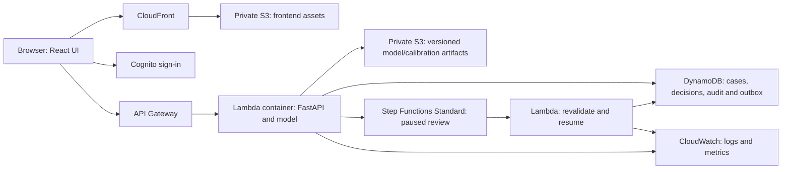

# WaferGuard — completed work and AWS deployment plan

Status checked November 13, 2026. No WaferGuard resources have been deployed to AWS.
The authenticated CLI profile is awsnew; default workload Region is us-east-2.
Individual gate reviews remain required.

## Completed locally

1. Foundation: project structure, pinned dependencies, CI definitions, security/data cards,
   architectural decisions, threat model, architecture.drawio and operational instructions.
2. Real data: acquired WM-811K, preserved originals/hash provenance and verified 811,457
   maps / 172,950 labeled records. Raw data is excluded from Git.
3. Data preparation: categorical encoding, duplicate/rotation/reflection grouping, conflict
   quarantine and immutable splits. Final cohort: 169,659 consistent representatives;
   train 118,677; validation 17,021; calibration 17,025; test 16,936.
4. Baselines: majority, spatial-feature random forest and compact CNN with stored validation
   predictions, confusion matrices and training/checkpoint evidence.
5. Advanced ML: weighted loss, replacement sampling, D4 augmentation and a second lightweight
   architecture; preserved failed experiments and evaluated a balanced candidate.
6. Uncertainty: temperature scaling fitted on calibration only, ECE/Brier/NLL/reliability,
   validation-selected selective-risk policy, training-only distance guard, engineered
   stress checks and cluster-bootstrap intervals. Model/policy were frozen before test.
7. Qualification: frozen test macro-F1 .7265, Scratch recall .5556 and precision .0994.
   Four true Scratch cases were falsely accepted by the unchanged offline policy. Release
   qualification failed; operational automatic acceptance and promotion remain disabled.
8. Verification: 70 Python tests passed. Reports, actual metrics, PNG/SVG figures and
   content hashes are saved. Passing software tests does not establish safe detection skill.
9. AWS authentication: awsnew sign-in verified and profile Region set to us-east-2.

## Draft / not completed

FastAPI endpoints, authorization helpers, atomic case/audit persistence, workflow handling,
and AWS adapters exist as draft source. Six synthetic review tests are included, but no
live Cognito/Step Functions/DynamoDB end-to-end reviewer workflow is verified.

The React application is not built. No application Docker image/ECR deployment, complete
application CDK stack, hosted frontend, live endpoint, model registry promotion, AWS cost
measurement, operational fault test or production validation is complete.

Current CDK and scripts/deploy.sh cover only three private/versioned S3 buckets, access
logging and budget warning definitions. They do not deploy the full application. A complete
budget-alert email address is still needed before budget deployment. Source is now public
on GitHub, hosted project checks have passed, and the static portfolio and campaign pages
are on GitHub Pages. This public documentation hosting does not deploy the AWS application.

## Target architecture — proposed, not deployed

Reviewer decisions return through the authenticated API. Validate identity/role, expiry,
case version and model/calibration/policy versions before resuming. Callback task tokens
stay server-side. Classification approval is simulated quality disposition, never physical
wafer release. ECR stores application images; Secrets Manager holds session secrets.
CloudTrail and scoped IAM support operational auditing. Registry, event retries/DLQ,
drift instrumentation and OIDC deployment are later infrastructure/MLOps work.

Use a Python Lambda container for the proposed FastAPI/PyTorch runtime, with packaging
and runtime behavior verified against AWS documentation. Serve frontend assets privately
through CloudFront OAC. Use Step Functions Standard for the planned callback-token review.
CloudFront is global; regional application/data services remain in us-east-2.

## Remaining order of work

1. Review Gate 4. Decide between a strictly manual-review-only research demo and further
   modelling with an explicit evaluation protocol. The observed test set cannot be used
   for tuning or called untouched. The current unqualified model must not be silently promoted.
2. Finish Gate 5 review correctness and authorization: restart durability, stale/conflicting/
   expired/replayed decisions, permissions revalidation, callback reconciliation and audit.
3. Package a versioned research/qualified inference release with explicit serving controls;
   build and verify its Docker image, API contracts and model/calibration identity checks.
4. Build the React inspection, performance, review queue and MLOps/audit pages using real
   evidence and visibly isolated demo decisions.
5. Extend CDK for ECR/Lambda, API Gateway, Cognito, DynamoDB, Step Functions, S3/CloudFront,
   secrets, retries, logs/alarms, scoped roles and retention. Resolve the recorded CDK tooling
   advisory before deployment review; no blanket security pass is claimed.
6. Review cdk synth/diff, budget recipient and cleanup behavior; deploy the approved scope
   using awsnew in us-east-2. Storage/website deployment is distinct from model promotion.
7. Measure live authentication, inference latency, review pause/resume, fault behavior,
   model rollback, actual cost and teardown. Record gate evidence before portfolio release.

[High-level diagram](architecture.html): the first draw.io tab shows the target user flow;
the second shows the authored foundation. [Editable source](architecture.drawio).
See [Gate 4 report](../reports/gates/gate_4.md) and [model card](model_card.md).

Implementation references: [Python Lambda containers](https://docs.aws.amazon.com/lambda/latest/dg/python-image.html),
[Step Functions callback patterns](https://docs.aws.amazon.com/step-functions/latest/dg/connect-to-resource.html#connect-wait-token),
[CloudFront private S3 access](https://docs.aws.amazon.com/AmazonCloudFront/latest/DeveloperGuide/private-content-restricting-access-to-s3.html).
