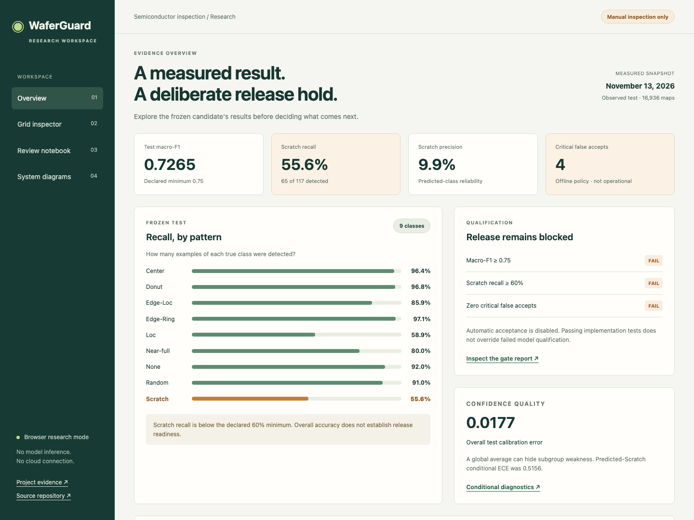
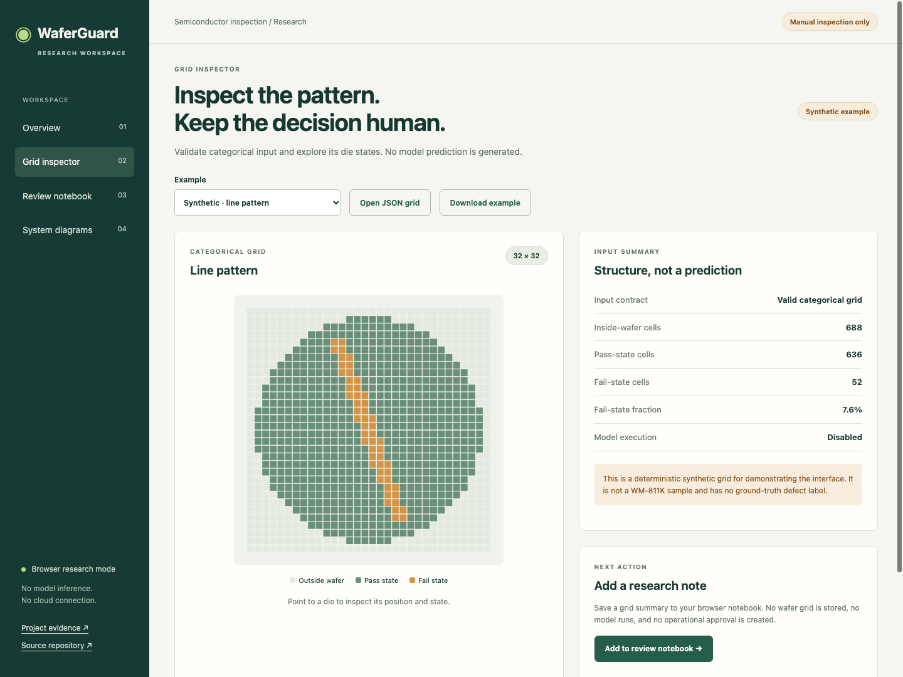
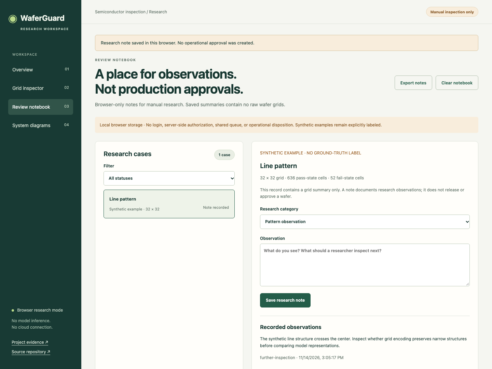
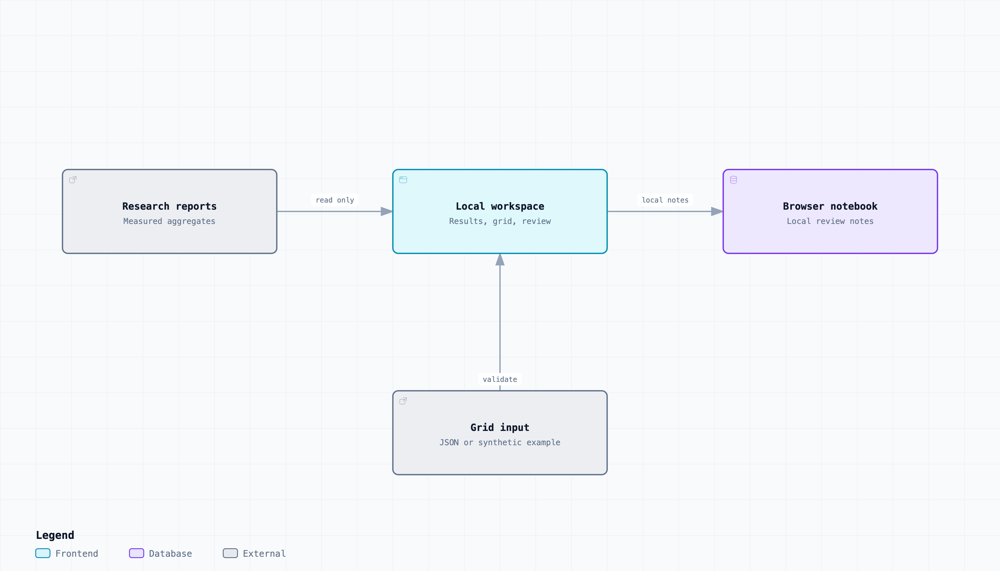
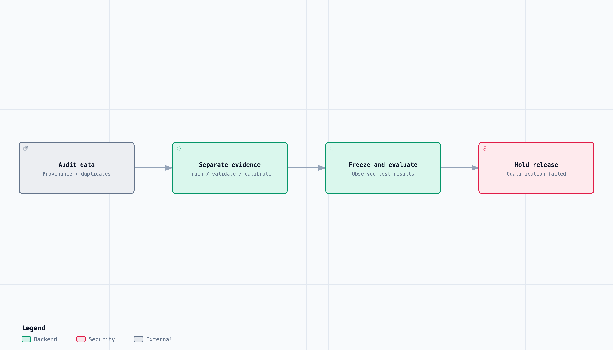

# WaferGuard AI

A local semiconductor wafer research workspace with audited WM-811K evidence,
measured model results, categorical-grid inspection, and browser-only research notes.

**Owner:** WaferGuard contributors · **Region:** `us-east-2` · **CLI profile:** `awsnew`

[Project website](https://manisa504.github.io/waferguard-ai/DOC/) ·
[Campaign studio](https://manisa504.github.io/waferguard-ai/DOC/campaign.html) ·
[Simple diagrams](https://manisa504.github.io/waferguard-ai/DOC/architecture.html) ·
[Open the research app](https://manisa504.github.io/waferguard-ai/DOC/app/) ·
[Downloadable campaign brief](DOC/CAMPAIGN_BRIEF.md).

The campaign includes 12 daily post drafts, four carousel outlines, a 90-second video
script, and a case-study brief. The actual video and Vercel URL are pending. The static
portfolio is separate from the research application's AWS deployment and model release.

## Local app and screenshots

Run the app without cloud credentials or package installation:

```bash
./scripts/run_local.sh
# Open http://127.0.0.1:8768/DOC/app/
```

Python 3.12+ serves an allowlist of public pages and aggregate reports on loopback.
The [same browser app is available on GitHub Pages](https://manisa504.github.io/waferguard-ai/DOC/app/).

- **Evidence overview:** reads actual frozen-test metrics and qualification from committed reports.
- **Grid inspector:** validates JSON categorical grids, visualizes die states, and supplies
  explicitly labeled deterministic synthetic examples. Uploaded grids stay in browser memory.
- **Research notebook:** saves summaries and observations in local browser storage, filters
  cases, and exports notes. It stores no raw grid arrays and creates no production approvals.
- **Simple diagrams:** show the local app and research decision flow without cloud-service icons.

These are actual Chrome screenshots captured from the running local app on November 14,
2026. The inspector and notebook show synthetic UI examples, not real dataset samples
or model predictions. The dashboard shows real aggregate evaluation results. This app
performs **no model inference** and does not change the failed model qualification.

### Evidence overview



### Grid inspector — synthetic example



### Browser research notebook



[All screenshots, including mobile views](https://manisa504.github.io/waferguard-ai/DOC/screenshots.html) ·
[Capture receipt and source hashes](DOC/screenshots/receipt.json) · [App guide](DOC/LOCAL_APP.md).

## Simple diagrams

### How the local app works



[Explore the local-app diagram](https://manisa504.github.io/waferguard-ai/DOC/diagrams/local-app.html) ·
[SVG](DOC/diagrams/local-app.svg) · [Editable specification](DOC/diagrams/local-app.json).

### How the research reached its decision



[Explore the research flow](https://manisa504.github.io/waferguard-ai/DOC/diagrams/research-flow.html) ·
[SVG](DOC/diagrams/research-flow.svg) · [Editable specification](DOC/diagrams/research-flow.json).

## Current state

Gate 4 imbalance/calibration/robustness analysis is complete, but **model promotion is
blocked**. The frozen candidate scored **test macro-F1 0.7265**, **Scratch recall 55.6%**
and **Scratch precision 9.9%**. Its unchanged candidate policy falsely accepted four
true Scratch cases. Automatic acceptance stays disabled. No model or API is deployed. The browser research interface runs locally and on GitHub
Pages; it does not run inference or provide an operational reviewer service.
Human quality disposition remains simulated; no physical release is authorized.

[Gate 4 results and failure analysis](DOC/uncertainty_results.md) ·
[Current model card](DOC/model_card.md) · [Gate 4 report](reports/gates/gate_4.md).

The first audit confirms **811,457 maps**, **172,950 labeled**, and **638,507 unlabeled**.
It detects **114,858 duplicate map rows** and **14 conflicting-label map groups**.
These are data quality measurements, not model performance. Published lot counts differ
from the locally measured **46,293 distinct lot names**; do not substitute published counts
for measured evidence. See the [data card](DOC/data_card.md) and [split assessment](DOC/split_feasibility.md).

## Reproduce

Prerequisites: Python 3.12, [uv](https://docs.astral.sh/uv/), Node 24, npm, curl;
allow several GB of disk and memory for the original legacy pandas pickle.

```bash
./scripts/setup.sh
make check
make synth
# Download the pinned public archive, or verify the existing local copy:
uv run --frozen waferguard-acquire --metadata data/manifests/kaggle-source-search.json --download
make profile
```

The source archive is excluded from Git. The acquisition script checks its structure,
records source/license metadata and a local SHA-256, and refuses a changed archive
against an existing manifest. Profiling verifies that hash before using a restricted
legacy unpickler. A local hash is not an independently authenticated publisher checksum.
Use only the documented source; run deserialization in a resource-limited environment
without credentials. Restricted pickle loading is defense in depth, not a sandbox.

`pytest` uses explicitly synthetic fixtures for contracts and security checks.
It does not download data or establish detection performance. The initial GitHub
Project checks run passed. Dependency locks are included; dependency audit limitations are
recorded in [Gate 0](reports/gates/gate_0.md).

## Gate 2 benchmark

The final benchmark retains **169,659** unique, consistent labeled maps. It quarantines
28 conflicting records and removes 3,263 duplicate records, including nine additional
copies detected after encoding. Lot, source/encoded map and rotation/reflection
boundaries pass for representatives and excluded-copy membership. All nine classes
occur in every split. [Benchmark details and actual class counts](DOC/benchmark.md).

```bash
make split        # Verify/build index, encode categorical inputs, create immutable grouped splits.
make verify-data  # Repeat the split and check real-data loading; no model evaluation.
```

All derived row-level data stays under ignored `data/processed/`. Native originals stay
untouched. Encoding uses categorical nearest-neighbor sampling, 64×64 padding and
one-hot channels; resizing can remove small features. This is a pilot representation,
not a validated optimum. Changing representations requires a fresh split identity audit.

## Gate 3 measured baselines

| Model | Validation macro-F1 |
|---|---:|
| Majority | 0.1018 |
| Spatial-feature random forest | 0.7166 |
| Compact CNN, selected epoch 4 | 0.7707 |

These are historical Gate 3 validation-only results. The Gate 3 CNN missed every
validation Scratch case. Gate 4 subsequently calibrated a different candidate and
performed a frozen test evaluation; use the current model card for its failed qualification.
No automatic acceptance or promotion is enabled.
[Model card and limitations](DOC/model_card.md) · [Experiment evidence](experiments/README.md).

```bash
uv sync --extra dev --extra ml --frozen
make train
make check-ml
```

Training artifacts stay ignored under `artifacts/`; completed run receipts verify their
hashes. Linux ML installation uses PyTorch's CPU index. No GPU or cloud rental is used.
The CI definition includes a small synthetic ML-contract job; the initial hosted run passed.

## Review and next steps

Read the [Gate 4 report](reports/gates/gate_4.md), [Gate 3 report](reports/gates/gate_3.md), [Gate 2 report](reports/gates/gate_2.md), [outline](WAFERGUARD_PROJECT_OUTLINE.md), [Gate 0 report](reports/gates/gate_0.md),
[Gate 1 report](reports/gates/gate_1.md), [architecture](DOC/architecture.md),
[threat model](DOC/threat_model.md), and [deployment/cleanup guide](DOC/deployment.md).
Open `DOC/index.html` locally for the documentation index.

The outline and your latest preference require review between gates. Gate 4 produced
frozen test evidence and a failed release assessment; review it before further modelling
or an explicitly manual-review-only research workflow. The test set is now observed and
must not be reused for tuning or described as untouched.
Do not use the held-out test set to tune thresholds or hyperparameters. Validation and calibration are separate splits. Gate 0 live cloud checks remain outstanding.

AWS deployment requires a budget recipient and review of the CDK diff. Budget alerts
are warnings, not spending caps. Originals/artifacts are retained on stack deletion;
cleanup is documented and intentionally never empties data buckets automatically.

## Repository

- `src/waferguard/data`: acquisition, profiling, categorical preprocessing, grouping, split auditing and verified loading.
- `src/waferguard/api`, `approval`: future-gate drafts; not deployed or qualified as Gate 5.
- `src/waferguard/features`, `models`, `training`, `evaluation`: spatial baselines, CNN and measured experiments.
- `configs`: source expectations, pinned training config and inactive review policy.
- `infrastructure/cdk`: private versioned S3, access logs, budget warnings, security validation.
- `tests`: synthetic data contracts and malicious-input checks.
- `.github/workflows/ci.yml`: lint, unit/security tests, CDK checks, raw-data tracking guard.
- `DOC`: charter, ADRs, architecture, data/model cards, threat model, deployment instructions.
- `reports`: actual data measurements, command evidence, and gate decisions.

Code is MIT licensed. Dataset terms are separate; source metadata lists CC0.
No raw maps or derived wafer examples are published in this repository.
